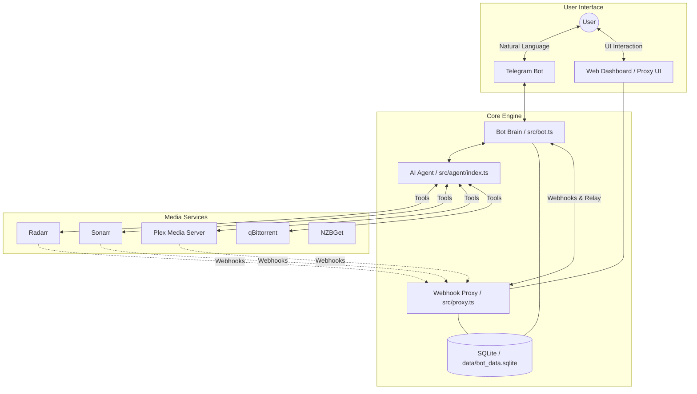
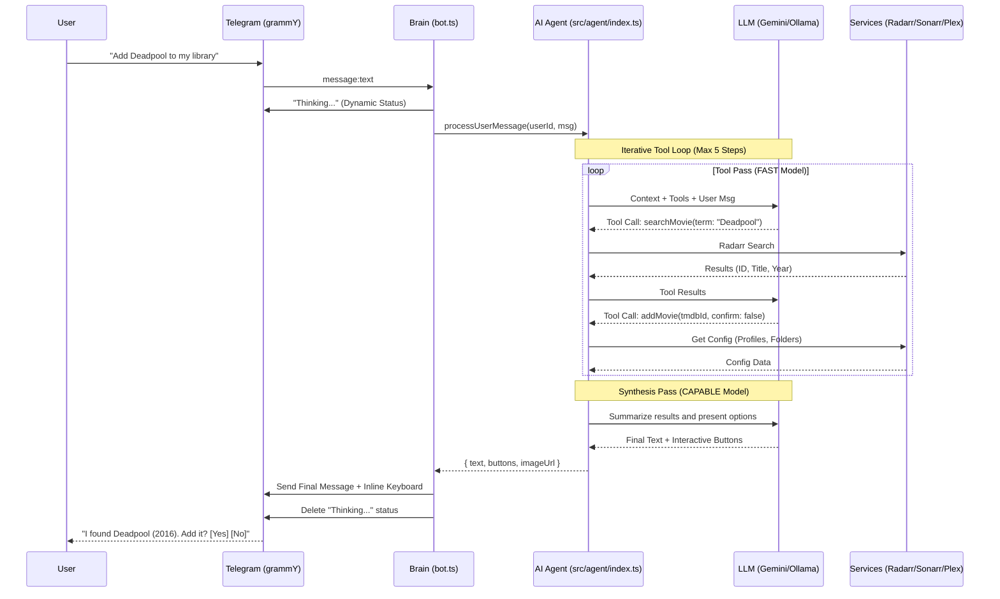
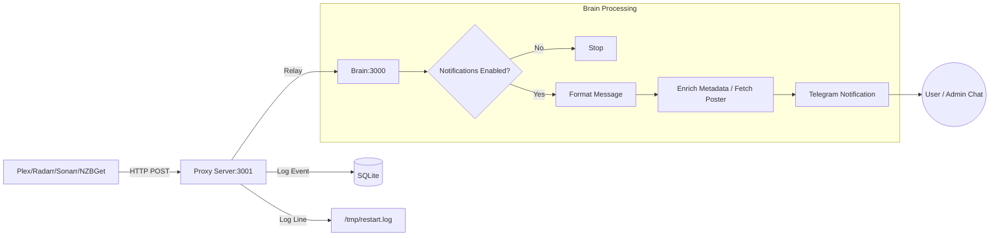

# Agentic Media Bot Documentation

The **Agentic Media Bot** is a sophisticated, AI-powered Telegram assistant designed to manage a home media stack (Radarr, Sonarr, Plex, qBittorrent, NZBGet) using natural language. It combines a conversational interface with modular tool execution and a dedicated web dashboard.

---

## 1. System Architecture

The bot follows a modular architecture where the **Telegram Bot** acts as the user interface, the **AI Agent** provides the intelligence, and the **Webhook Proxy** handles external signals and provides a management dashboard.

### High-Level Architecture

---

## 2. Message Processing Flow

When a user sends a message, it undergoes a two-pass AI processing cycle to ensure accurate tool execution and natural synthesis.

### Interaction Sequence

---

## 3. Webhook and Notification System

The bot processes external events from media services to provide real-time updates.

### Event Flow

---

## 4. Component Details

### `src/bot.ts` (The Interface)
- **Telegram Logic**: Uses `grammY` for high-performance bot polling/webhooks.
- **Instance Management**: Implements a PID-based leader election via SQLite to prevent duplicate bots from crashing with 409 conflicts.
- **Command Handling**: Direct commands like `/status` (health), `/restart` (self-update), and `/audit` (logs).
- **Thinking Protocol**: Updates a "Thinking..." message in real-time as the agent works through multi-step tool calls.

### `src/agent/index.ts` (The Intelligence)
- **Dual-Model Approach**: Uses a fast model (e.g., Gemini Flash) for logic and tool execution, and a capable model (e.g., GPT-4/Gemini Pro) for final language synthesis.
- **Tool Orchestration**: Manages the iterative loop where the AI can "search first, add later" or "check library before suggesting".
- **Language Guard**: Automatically detects user language (English/Spanish) and ensures the final response matches, including translation of technical terms.

### `src/agent/tools.ts` (The Capabilities)
- **Radarr/Sonarr**: Search, add, remove, and queue management. Implements a "search first" requirement for IDs.
- **Plex**: Deep library browsing by title, genre, country, or duration.
- **qBittorrent/NZBGet**: Torrent/NZB management (pause, resume, list, and queue status with speed/ETA).
- **Internal**: Service health checks and library auditing (missing episodes/movies).

### `src/services/database.ts` (The Memory)
- **SQLite Persistence**: Stores chat history, user preferences (names), playback states (to prevent duplicate Plex pings), and a persistent log of all media events.
- **History Management**: Automatically trims conversation history to the last 20 messages per user to maintain model accuracy.

### `src/proxy.ts` (The Infrastructure)
- **Webhook Gateway**: A high-availability endpoint that logs all external signals even if the main bot is restarting.
- **Web Dashboard**: Serves a React frontend for system health monitoring, log viewing, and notification configuration.
- **Remote Execution**: Allows the agent to trigger tools on the proxy server if the main bot is running in a restricted environment.

---

## 5. Deployment and Setup

The bot is designed to be self-hosted and includes a guided setup tool.

- **`src/setup.ts`**: Interactive CLI that walks the user through API key configuration, service discovery (auto-detecting Plex sections), and systemd service creation.
- **Systemd Integration**: Can be installed as a Linux user service for automatic restarts on boot.
- **Docker-Ready**: Configured for persistent volume mapping at `/app/data` to preserve the SQLite database and logs.
